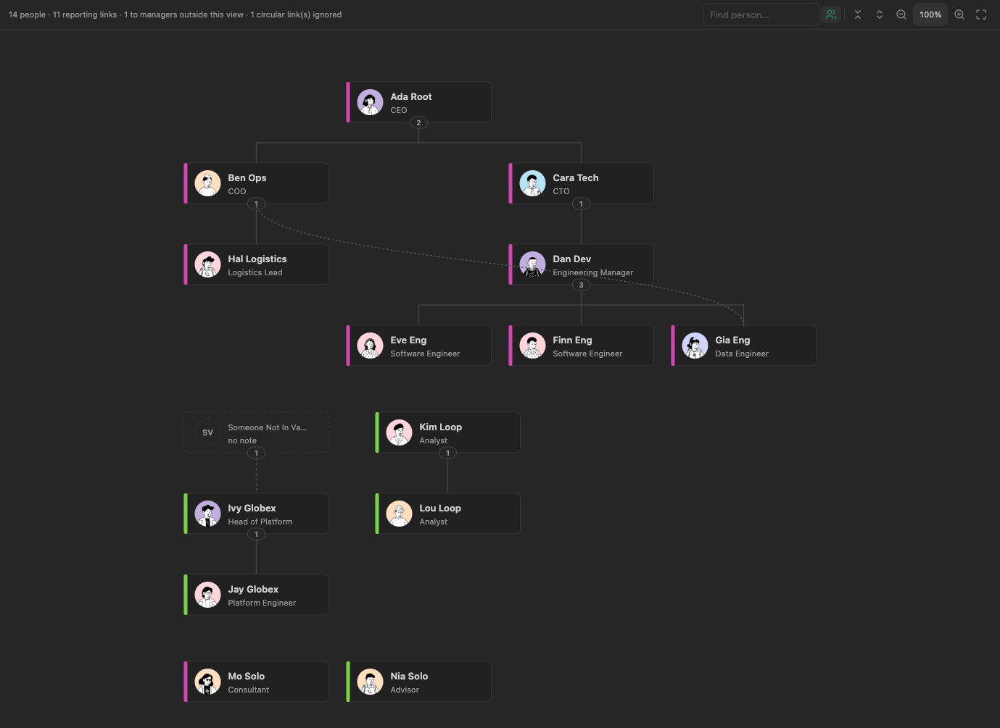

# Bases Org Chart

An Obsidian plugin that adds an **Org Chart** view type to [Bases](https://help.obsidian.md/bases), rendering notes as a parent → child hierarchy driven by a configurable frontmatter property (default `reports_to`).

Works with any set of notes that link to a parent: org charts, team structures, project breakdowns.

## Installing

Requires Obsidian 1.13 or later, on desktop. Phones and tablets aren't supported yet.

- **From Obsidian:** Settings → Community plugins → Browse, search for "Bases Org Chart", then Install and Enable.
- **Manually:** download `main.js`, `manifest.json` and `styles.css` from the latest [release](../../releases), put them in `<your vault>/.obsidian/plugins/bases-org-chart/`, then enable the plugin under Settings → Community plugins.

## Getting started

1. Give each note a parent property, e.g. `reports_to: "[[Jane Doe]]"` (the first value is the main manager; more values are dotted lines).
2. Create or open a base, add a view and choose **Org Chart** as its layout. Use the base's **Filter** button to choose which notes appear.
3. Optionally, set card fields, colours and avatars in the plugin's settings, and per view under **Configure view**.

## Using the chart

- **Pan:** drag empty space, or scroll with a trackpad or mouse wheel. Panning stops at the chart's edges, so it can't be scrolled off screen. In a chart embedded in a note, scrolling moves the note instead, so reading the note never gets stuck on the chart; drag to pan there.
- **Zoom:** pinch on a trackpad, or Ctrl/Cmd + scroll. Toolbar buttons (hover for a tooltip) zoom in, zoom out and fit to view; the percentage between them shows the current zoom, and clicking it resets to 100%. With the chart focused, `+` `-` `0` and the arrow keys also work.
- **Collapse a team:** click the count pill under a manager. Clicking a collapsed manager's card expands the team again. "Collapse all" and "Expand all" are in the toolbar.
- **Show everyone:** the people button in the toolbar shows people with no reporting links (they sit in a grid under the trees); the history button shows former members, drawn dimmed. Both are saved per view.
- **Change someone's manager:** drag their card onto the new manager and confirm. The new manager becomes the first value of the parent property; any other (dotted-line) values are kept. The change is saved through Obsidian's own frontmatter API, the same way the Properties panel saves edits, and the notice that follows has an Undo link. If the note changed since the chart last read it, or the property holds values other than plain text, nothing is written and a notice says why. Dropping onto yourself, someone in your own team, your current manager or a placeholder without a note isn't allowed (the target turns red). Drag near the edge to scroll; Escape cancels.
- **Remove a reporting line:** click a line (solid or dotted; it turns red on hover) and confirm. The dialog says what happens next, e.g. that a dotted-line manager becomes the main one, or that the person will have no manager. Undo is offered afterwards.
- **Add a dotted-line manager:** right-click someone who already has a manager and choose "Add dotted-line manager…". Pick a person from the list (yourself, existing managers and your own team are left out), confirm, and they're added after the existing values of the parent property, so the main manager stays first. Undo is offered afterwards.
- **Leave a group:** right-click a card and choose "Remove from …" for one of the values in the current membership property. After confirming, the value is removed there and added to the former members property (unless it's already listed). If they manage anyone, the dialog also offers (on by default) to move their reports to their own manager: the leaver's place as main manager is taken by that person, and dotted lines to the leaver are dropped. Undo is offered afterwards and restores every changed note.
- **Right-click menu:** a card's menu starts with the chart's own actions (editing its fields, adding a dotted-line manager, leaving a group). With "Note actions on right-click" on (the default), Obsidian's usual actions for the note follow, as on Bases' cards: open in a new tab, to the right or in a new window, rename, move, copy path, reveal, other plugins' items, and Delete file last, which uses Obsidian's own delete prompt. With it off, the menu has the chart's actions and Open in new tab.
- **Group:** use Bases' **Group** button on a view (e.g. group by a `teams` property). Each group becomes a labelled box with its own reporting tree; main reporting lines between groups are drawn as solid curves, and people without a value go in a "No value" box. A person whose value is a list lands in a box for that combination, as Bases groups them.
- **Find:** type in the toolbar box to highlight people whose name or card fields contain every word you typed, in any order; Enter (Shift+Enter) jumps to the next (previous) one, expanding collapsed teams as needed.
- **Edit a card:** double-click it, press Enter on a focused card, or choose "Edit fields" from its right-click menu. A panel opens over the card, headed by the note's file name, with a box for the name (when it comes from the name property) and each field shown on the card, including empty ones, so they can be filled in. Clearing the name empties the property, so the card shows the file name again. Enter saves, Escape cancels, and clicking elsewhere saves. Only the properties you changed are written, through Obsidian's own frontmatter API, and the notice that follows has an Undo link. If the note changed since editing started, nothing is written and a notice says why. Lists, links and checkboxes, and a name taken from the file name, aren't edited here; a card with nothing to edit opens its note instead.
- **Open a note:** Cmd/Ctrl-click a card to open it in a new tab (Obsidian's usual modifier combinations open it in a split or a new window), or choose "Open in new tab" from its right-click menu. A single click just selects it. Mod-hover previews the note.

A view opens at 100% zoom, centred on the chart (or on the head of the largest org when the chart is bigger than the pane). Switching to another Org Chart view in the base re-centres, unless "Restore views when switching back" is on. Zoom level and collapsed teams are kept while you stay on a view, and when Obsidian brings it back, for example after switching to a table view and back.

## Settings

For a walkthrough with before-and-after screenshots, see [docs/settings.md](./docs/settings.md).

Which notes appear in a chart is decided by the base's own filters (Bases' **Filter** button), so the plugin works with any kind of note. The settings below only say which properties to read. They're defaults for every Org Chart view; most can be overridden per view in Bases' **Configure view** panel.

| Setting | Default | Description |
| --- | --- | --- |
| Parent property | `reports_to` | Links a note to its manager/parent. First value is the primary manager; extra values draw as dotted lines. |
| Name property | (file name) | Shown as the card's name. Links show their alias. |
| Card fields | none | Up to 5 properties shown under the name, in the order listed (drag to reorder). Turn off "Show on card" to keep a field in the hover tooltip only. Empty values are skipped; cards grow to fit the busiest one. |
| Colour by property | none | Colour stripe per distinct value. |
| Image property | `image` | Avatar image from a vault link (`[[pic.jpg]]`, `![[pic.jpg]]`). HTTP(S) URLs also work when remote avatar images are explicitly enabled. Cards without an image show initials. |
| Allow remote avatar images | Off | Permits HTTP(S) avatar URLs to contact hosts outside the vault. Keep this off for untrusted or shared note collections. |
| Note actions on right-click | On | A card's right-click menu also shows Obsidian's usual actions for the note, as on Bases' cards, with Delete file last. Off: only the chart's actions and Open in new tab. |
| Current membership property | none | Groups a person currently belongs to (team, organisation…); enables the right-click "Remove from …" action. |
| Former members property | none | Where groups a person has left are recorded. See "Former members" below. |
| Large chart warning threshold | 2000 | Pause before drawing a chart with more people than this, with a "Render anyway" button. 0 turns the warning off. |
| Layout direction | Top to bottom | Or left to right. |
| Restore views when switching back | Off | Switching back to an Org Chart view in a base shows the zoom and collapsed teams it had, instead of re-centring. |

Settings are grouped into Reporting lines, Cards, Card fields, Groups and teams, and Layout, and appear in Obsidian's settings search. Card fields can be dragged to reorder. Every property box suggests the property names used in your vault.

The parent, current membership and former members properties hold lists, so the chart always writes them as lists, even with a single value. The plugin also gives them Obsidian's List property type (as set in the Properties view), so Obsidian shows and edits them as lists too. It does this for the properties in its settings when it loads and after you change these settings, and for any property it's about to edit, such as a view's own parent property. A property that had another type, such as Text, becomes a List; notes holding a single value still show it, as a one-item list.

Per-view only:

| Option | Default | Description |
| --- | --- | --- |
| Show former members | Off | Include notes matching the former-member rule; they're drawn dimmed. |
| Former when property … contains | — | A note is a former member when this property contains the given value (a link target or text). The value is a Bases formula: put text in quotes (`"Acme"`), or use `this.file.name` for the note the view is embedded in, so one view works on every note. In a base open in its own tab, `this` is the note you opened last, as in Bases filters. When Bases can't evaluate the value, its text is used as it is, so `Acme` without quotes also works. Leave empty to disable. |
| Hide people with no reporting links | Off | Drops notes with no manager, no reports and no dotted-line links. |
| Stack teams larger than | 6 | Teams whose members have no reports of their own are stacked in columns above this size. 0 never stacks. |
| Initially expand levels | 0 (all) | Collapse everything below this many levels when the view opens. |

### Reports of former members

When someone's main manager is a former member, the status line shows "⚠ N reporting to former members". Click it to jump to each of those people in turn. The manager's card gets a warning border (a hidden former member appears as a placeholder labelled "former member"), the reporting lines turn the warning colour, and each affected person gets a "!" badge. Nothing is changed automatically; drag them to their new manager when you know who it is.

### Former members

When shown, former members stay visible even if "Hide people with no reporting links" is on. When hidden, they're removed before the chart is built, so anyone who reported to them shows their manager as "outside this view" rather than disappearing.

### Compatibility

A few features rely on parts of Obsidian that aren't public API. If a future Obsidian release changes them, these degrade as follows, and everything else keeps working:

- **Property-name suggestions** in settings use Obsidian's property registry. If it changes, the suggestions go empty.
- **List type for the plugin's properties** also uses the property registry. If it changes, property types are left as they are; values are still written as lists.
- **Keeping zoom and collapsed teams** when Obsidian brings a view back uses the state Bases keeps for its views. If it changes, views open re-centred instead.
- **Scroll in embedded charts** depends on telling a chart in its own tab from an embedded one, which uses Obsidian's page layout. If it changes, scrolling stops panning charts; dragging still pans.

## Contributing

This plugin was generated with AI assistance from a personal need, and is shared for others to use, tinker with and fork. It aims to do one thing: show notes in Bases as an org chart. Contributions that keep to that are welcome; see [CONTRIBUTING.md](./CONTRIBUTING.md) for scope, building, testing and conventions.

## License

MIT — see [LICENSE](./LICENSE).
