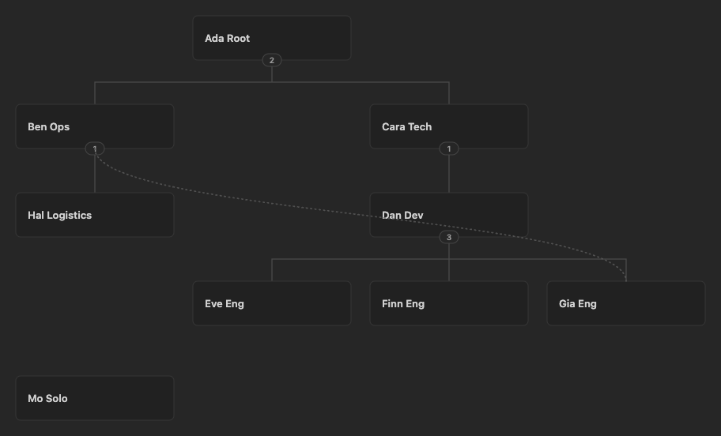
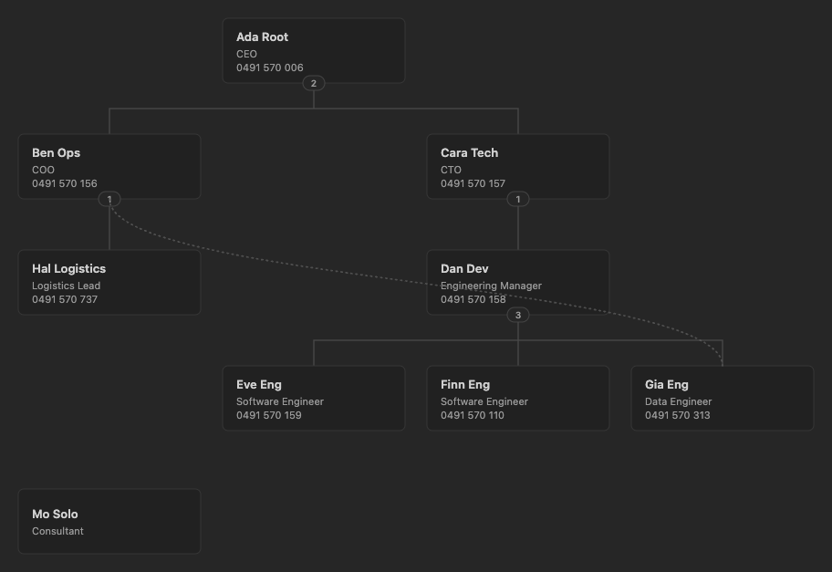
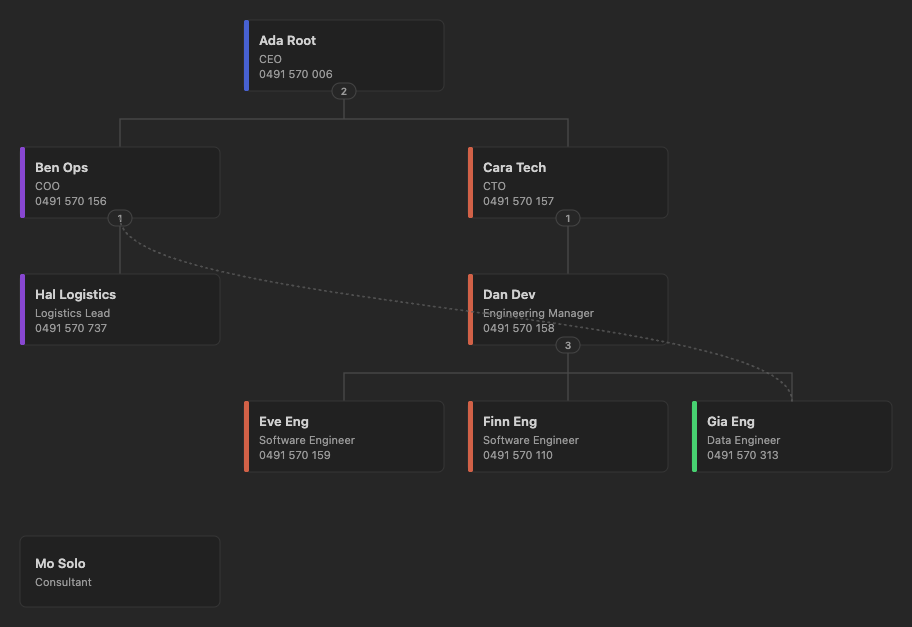
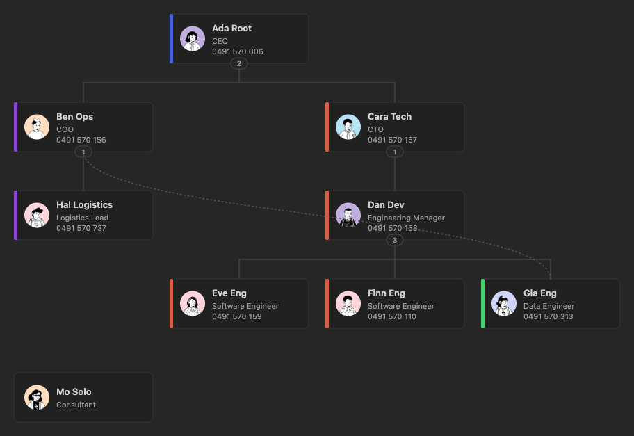
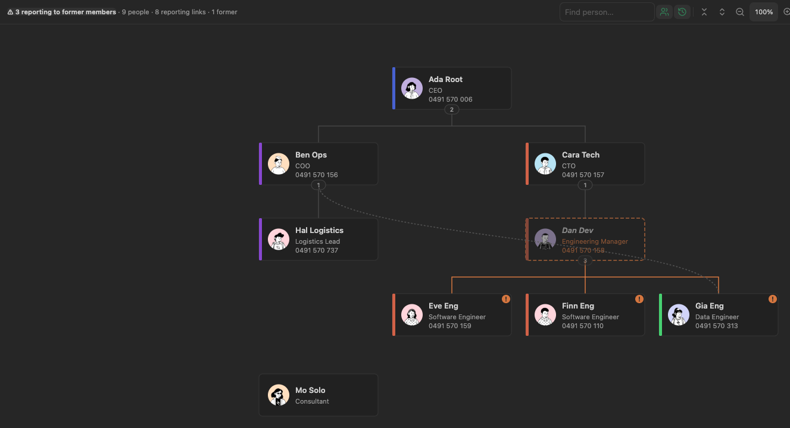

# Org Chart settings

All people, phone numbers and e-mail addresses in these screenshots are fictional. Phone numbers are from the list of numbers reserved in Australia for use in fiction (such as 0491 570 006), and e-mails use the reserved `example` domain.

## Where settings live

- **Which notes appear** is set by the base, not the plugin. Use the base's **Filter** button (e.g. `type == "Person"`, or `companies.contains(link(this.file.name))` in a view embedded on a company note).
- **Plugin settings** (Settings → Bases Org Chart) say which properties to read. They apply to every Org Chart view.
- **Per-view options** (the view's **Configure view** panel) override most plugin settings for that view only, and add options of their own.

Empty property settings switch that feature off.

## Reporting lines

**Parent property** (default `reports_to`) links each note to its manager. The first value is the main manager and decides where the card sits. Any further values are dotted-line managers, drawn as dotted curves that don't move the card.

```yaml
reports_to:
  - "[[Cara Tech]]"   # main manager
  - "[[Ben Ops]]"     # dotted line
```

A manager who isn't in the view, or has no note, appears as a dashed placeholder card. Circular links are ignored and counted in the status line.

The parent property is a list: the chart writes it as one, even with a single value, and the plugin gives it Obsidian's List property type, so the Properties view shows it as a list too. The current membership and former members properties below work the same way.

## Cards

Each step below adds one setting to the one before, so consecutive pictures show the before and after.

### Name only

With no card fields, colour or image set, cards show just the name.



**Name property** chooses what's shown as the name. Leave it empty to use the file name. A link shows its alias.

### Card fields

Up to five properties shown under the name, in the order listed. Drag rows to reorder them. The toggle on each row decides where the field appears:

- **On:** shown on the card and in the hover tooltip.
- **Off:** shown only in the hover tooltip, which lists every field as `property: value`.

Empty values are skipped. Every card grows to the height of the card with the most lines.

Here the fields are `role` (on), `phone` (on) and `e-mail` (off), so cards show role and phone, and the e-mail address only appears on hover.



### Colour by property

Adds a colour stripe for each distinct value of a property (the first value, if it's a list). The same value always gets the same colour. Here the colour is by `teams`.



### Image property

Shows an avatar from a property holding a vault image link (`"[[portrait.png]]"`). Cards without an image show the person's initials. Avatars only appear when at least one person in the chart has an image.

HTTP(S) image URLs are blocked by default because loading one contacts its host. Enable **Allow remote avatar images** under the plugin's Cards settings only when you trust the notes and image hosts.



### Card menu

Right-clicking a card shows the chart's own actions first: **Edit fields**, **Add dotted-line manager…** and **Remove from …**. With **Note actions on right-click** on (the default), Obsidian's usual actions for the note follow, as on Bases' cards: open, rename, move, copy path, reveal and other plugins' items, with **Delete file** last. Delete uses Obsidian's own prompt, so it asks first unless that's turned off in Obsidian's settings. With the setting off, the menu has only the chart's actions and **Open in new tab**.

## Groups and teams

To show teams as boxes, keep each person's teams in a list property (e.g. `teams`) and group a view by it with the base's **Group** button. Each group becomes a box with its own reporting tree. Reporting lines between boxes are drawn as solid curves, and people without a value go in a **No value** box at the end. Someone in two teams lands in a box for that combination, as Bases groups lists.


**Current membership property** (e.g. `companies`) lists the groups a person belongs to now. It enables the card's right-click **Remove from …** action.

**Former members property** (e.g. `companies_previous`) records groups a person has left. **Remove from …** moves the value there, and can also move the leaver's reports to the leaver's own manager.

### Former members

A view marks someone as a former member when the **Former members property** contains the view's **…contains** value (Configure view). The value is a Bases formula: put text in quotes, such as `"Acme"`, or use `this.file.name` in a view embedded on a note to mean that note, so one view works on every company note. (In a base open in its own tab, `this` is the note you opened last, as in Bases filters.) When Bases can't evaluate the value, its text is used as it is. Former members are hidden unless the view's **Show former members** option (or the toolbar's history button) is on, in which case they're drawn dimmed.

When someone's main manager is a former member, the status line warns about it. Click the warning to jump to each person in turn. The manager's card and the affected reporting lines turn the warning colour, and each affected card gets a "!" badge. Nothing is reassigned automatically.



## Layout

**Layout direction** sets top-to-bottom or left-to-right for new views. Each view can override it.

**Restore views when switching back** (off by default): when you switch back to an Org Chart view in a base, it shows the zoom and collapsed teams it had. When off, it opens re-centred.

**Large chart warning threshold** (default 2000, up to 10,000) pauses before drawing a chart with more people than this, so a broad filter doesn't freeze the app. A **Render anyway** button draws it for that view; the prompt returns if more people are added. Set it to 0 to turn the warning off.

Per-view options in **Configure view**:

| Option | Default | What it does |
| --- | --- | --- |
| Show former members | Off | Include former members, drawn dimmed. |
| Hide people with no reporting links | Off | Hide people with no manager, no reports and no dotted lines. Otherwise they sit in a grid under the trees. |
| Stack teams larger than | 6 | Stack a manager's reports in columns when there are more than this many and none of them manage anyone. 0 never stacks. |
| Initially expand levels | 0 (all) | Collapse everything below this many levels when the view opens. |
